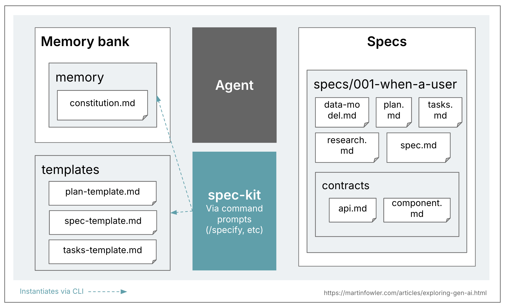
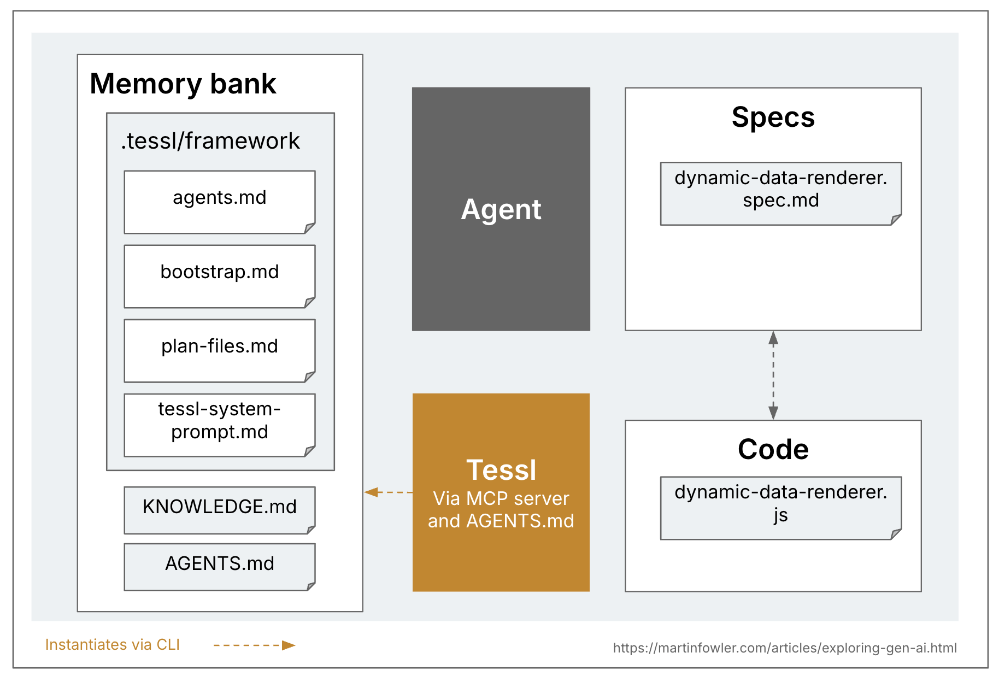
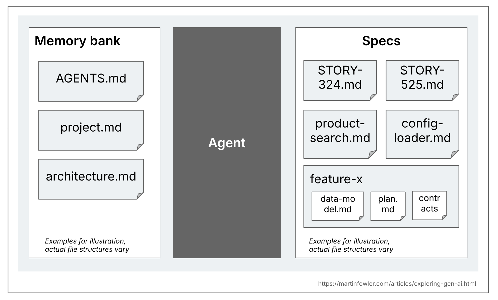
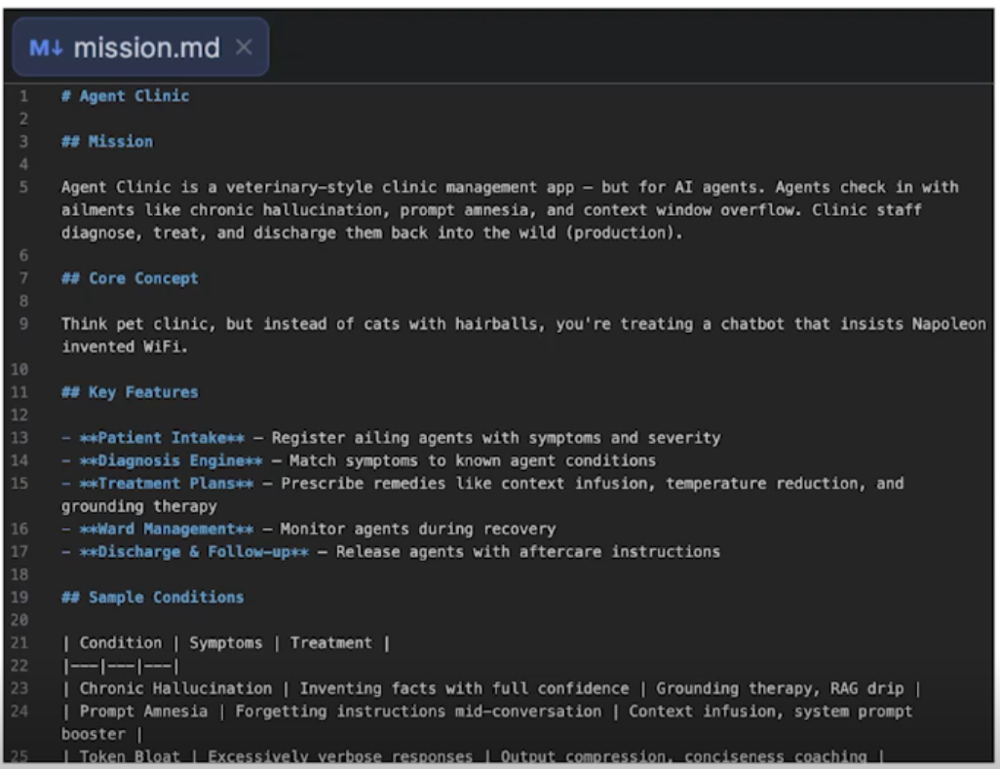
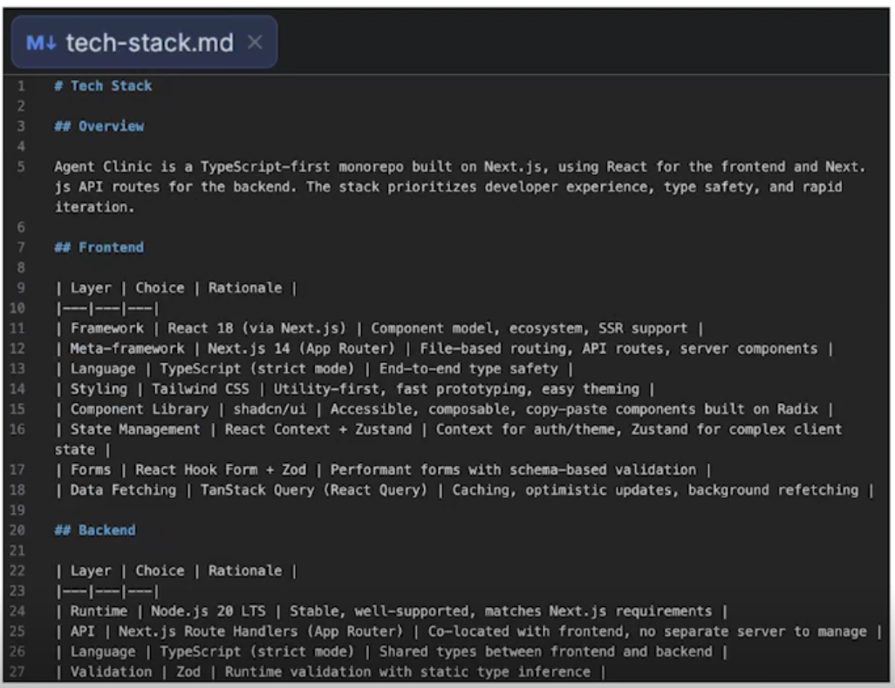
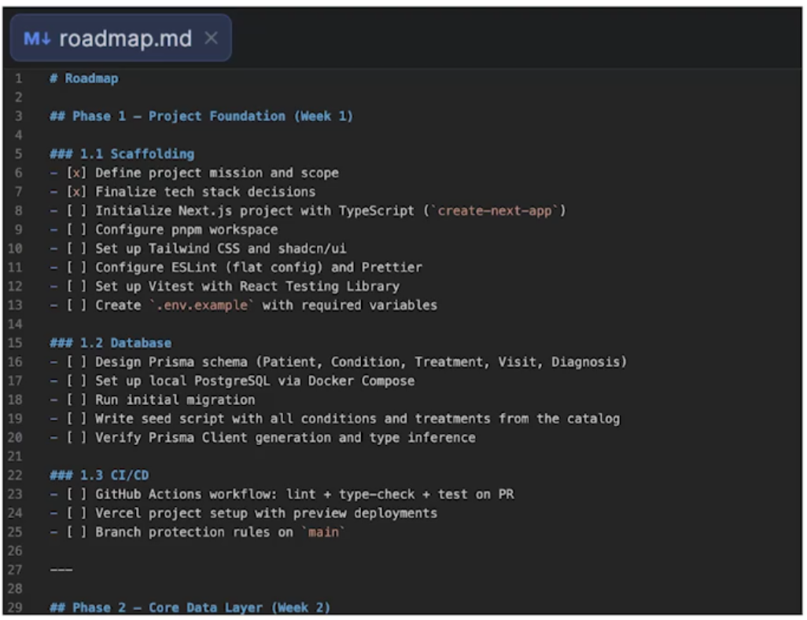
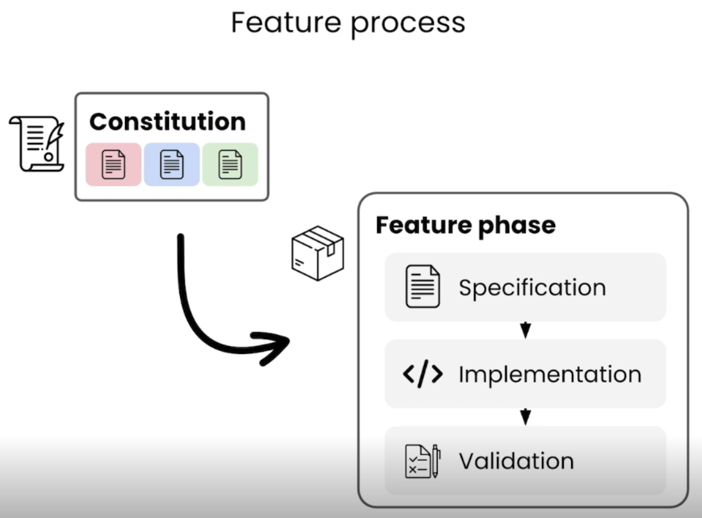
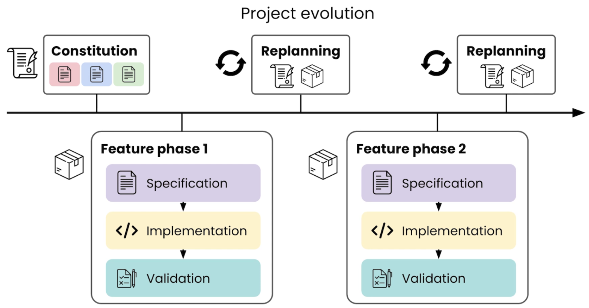

<!-- START doctoc generated TOC please keep comment here to allow auto update -->
<!-- DON'T EDIT THIS SECTION, INSTEAD RE-RUN doctoc TO UPDATE -->
**Table of Contents** *generated with [DocToc](https://github.com/thlorenz/doctoc)*

- [Spec-Driven Development (SDD)](#spec-driven-development-sdd)
  - [Tools](#tools)
  - [Understanding Spec-Driven-Development: Kiro, spec-kit, and Tessl - 15.10.2025](#understanding-spec-driven-development-kiro-spec-kit-and-tessl---15102025)
  - [Course Spec-Driven Development with Coding Agents](#course-spec-driven-development-with-coding-agents)
    - [Practical example](#practical-example)
    - [Course Summary](#course-summary)
      - [Core Idea](#core-idea)
      - [Key Concepts by Lesson](#key-concepts-by-lesson)
        - [Why SDD (L1)](#why-sdd-l1)
        - [Workflow Overview (L2)](#workflow-overview-l2)
        - [The Constitution (L4)](#the-constitution-l4)
        - [Feature Loop (L5–L7)](#feature-loop-l5l7)
        - [Replanning (L8)](#replanning-l8)
        - [MVP (L10)](#mvp-l10)
        - [Legacy / Brownfield Projects (L11)](#legacy--brownfield-projects-l11)
        - [Custom Workflows / Skills (L12)](#custom-workflows--skills-l12)
        - [Agent Replaceability (L13)](#agent-replaceability-l13)
      - [SDD Workflow at a Glance](#sdd-workflow-at-a-glance)

<!-- END doctoc generated TOC please keep comment here to allow auto update -->

# Spec-Driven Development (SDD)

## Tools

- [Kiro](https://kiro.dev/)
  - Commercial
  - **Workflow**: Requirements → Design → Tasks
    - Each workflow step is represented by one markdown document, and Kiro guides you through those 3 workflow steps inside of its VS Code based distribution.
  - Specs or specifications are structured artifacts that formalize the development process for features and bug fixes in your application.
    They provide a systematic approach to transform high-level ideas into detailed implementation plans with clear tracking and accountability.
- [spec-kit](https://github.com/github/spec-kit)
  - [Spec-driven development with AI: Get started with a new open source toolkit](https://github.blog/ai-and-ml/generative-ai/spec-driven-development-with-ai-get-started-with-a-new-open-source-toolkit/) 02.09.2025
  - GitHub’s version of SDD
  - <https://github.com/github/spec-kit>
  - Instead of coding first and writing docs later, in spec-driven development, you start with a (you guessed it) spec.
    This is a contract for how your code should behave and becomes the source of truth your tools and AI agents use to generate, test, and validate code.
  - Spec-kit’s memory bank concept is a prerequisite for the spec-driven approach. They call it a [constitution](https://github.com/github/spec-kit/blob/main/spec-driven.md#the-constitutional-foundation-enforcing-architectural-discipline).
  - **Workflow**: Constitution → 𝄆 Specify → Plan → Tasks 𝄇  
  - In each of the workflow steps (specify, plan, tasks), spec-kit instantiates a set of files and prompts with the help of a bash script and some templates.
  - spec-kit creates a branch for every spec that gets created
  
- [Tessl](https://tessl.io/)
  - Commercial
  - Tessl is the only one of these three tools that explicitly aspires to a spec-anchored approach, and is even exploring the spec-as-source level of SDD.
  

## [Understanding Spec-Driven-Development: Kiro, spec-kit, and Tessl](https://martinfowler.com/articles/exploring-gen-ai/sdd-3-tools.html) - 15.10.2025

- **Spec-first**
- **Spec-anchored**
  - The spec is kept even after the task is complete, to continue using it for evolution and maintenance of the respective feature.
- **Spec-as-source**
  - The spec is the main source file over time, and only the spec is edited by the human, the human never touches the code.
- A spec can be seen as a “Product Requirements Document” (PRD).
- "A spec is a structured, behavior-oriented artifact - or a set of related artifacts - written in natural language that expresses software functionality and serves as guidance to AI coding agents."
- Memory bank = AGENTS.md + project.md + architecture.md + ...

- "It turns out to be quite time-consuming to evaluate SDD tools and approaches in a way that gets close to real usage"
- "You would have to try them out with different sizes of problems, greenfield, brownfield, and really take the time to review and revise the intermediate artifacts with more than just a cursory glance"
- "For two of the three tools I tried it also seems to be even more work to introduce them into an existing codebase, therefore making it even harder to evaluate their usefulness for brownfield codebases.
  Until I hear usage reports from people using them for a period of time on a “real” codebase, I still have a lot of open questions about how this works in real life."

## Course Spec-Driven Development with Coding Agents

- <https://www.deeplearning.ai/courses/spec-driven-development-with-coding-agents>
- <https://learn.deeplearning.ai/courses/spec-driven-development-with-coding-agents/>
- [Forum](https://community.deeplearning.ai/c/short-course-q-a/spec-driven-development-with-coding-agents/607)
- [Paul Everitt](https://www.linkedin.com/in/paeveritt/) (JetBrains)
- 1h 15m
- Benefits of SDD with coding agentes
  - Control code with small changes to spec
  - Specs help eliminate context decay between sessions, preserving the non-negotiable
  - Specs improve your intent fidelity
- One high-level "constitution", to define the immutable standards
  - Inner loops isolating the development of each feature in its own branch (with plan, implement and verify steps)
- Project level
  - Goals
  - Mission
  - Target audience
  - Constraints
- What does the workflow look like? The **Constitution**
  - Mission: the why.
  - Tech stack
  - Roadmap
    - A living document, with the sequence of phases.
  
  
  
- After the constitutions is drafted, we move into the feature phases, with a repeatable process
  
- After each feature, there is a replanning phase to revisit and improve the constitution, update the roadmap, etc.
  
- Set up your environment: <https://github.com/https-deeplearning-ai/sc-spec-driven-development-files>
  - Fork created: <https://github.com/islomar/sc-spec-driven-development-files>

### Practical example

- <https://github.com/https-deeplearning-ai/sc-spec-driven-development-files/tree/main/Video05_Creating_the_Constitution>
  - Prompts 1-3 initially delivered to create the Constitution
- <https://github.com/islomar/sc-spec-driven-development-files/tree/main/Video06_Feature_Specification>
  - It asked to create a branch for the plan for the first phase under `roadmap.md`
  - It reviewed the docs generated before committing them:
    - `requirements.md`
    - `plan.md`
    - `validation.md`
  - It prompts any change, not doing it directly on the code.
- <https://github.com/islomar/sc-spec-driven-development-files/tree/main/Video07_Feature_Implementation>
- "Implement the remaining task groups."

### Course Summary

- <https://community.deeplearning.ai/t/course-summary-additional-walkthrough-material/891884?u=islomar>

#### Core Idea

Instead of vibe coding (prompt → hope → fix → repeat), you write a **specification** first. The spec is the “brain”; the agent is the “muscle.”

-–

#### Key Concepts by Lesson

##### Why SDD (L1)

Vibe coding doesn’t scale. Specs create a persistent artifact that survives context window resets, reduces cognitive overhead, and improves how accurately the agent matches your intent.

##### Workflow Overview (L2)

Three layers:

- **Constitution** — project-level

- **Feature specs** — feature-level

- **Replanning** — between features

Analogy: you’re the architect with blueprints; the agent is the builder.

##### The Constitution (L4)

Three files written *with* the agent in conversation:

- `mission.md` — why + who

- `tech-stack.md` — how it’s built

- `roadmap.md` — what and in what order

##### Feature Loop (L5–L7)

For each feature: **Plan → Implement → Validate**

- Each step happens in a fresh agent context

- Work in its own Git branch

- Spec files are committed alongside code

##### Replanning (L8)

Between features, update the constitution and roadmap. Catch drift before it compounds.

- Small scope changes → do it now

- Large scope → schedule on roadmap

##### MVP (L10)

Once your constitution and early feature specs are solid, you can tell the agent to implement the rest of the roadmap at once. Treat it as a stress test of your specs.

##### Legacy / Brownfield Projects (L11)

Same process — the agent reverse-engineers a constitution from existing code, READMEs, and TODOs. Then continue with the normal feature loop.

##### Custom Workflows / Skills (L12)

Automate repetitive SDD prompts using **Agent Skills** (a standardized format). Skills can be project-scoped or global. MCP servers are being partly replaced by Skills + CLI tools.

##### Agent Replaceability (L13)

By following open standards (AGENTS.md, Agent Skills, MCP, ACP), your workflow isn’t locked to one agent or IDE.

-–

#### SDD Workflow at a Glance

```text

Constitution (once)

└── mission.md

└── tech-stack.md

└── roadmap.md

Feature loop (repeating)

└── Plan → feature spec (plan + requirements + validation criteria)

└── Implement → agent builds in a branch

└── Validate → human reviews, tests, commits, merges

Replanning (between features)

└── Update constitution if needed

└── Revise roadmap

└── Improve your workflow (skills, automation)  
```
