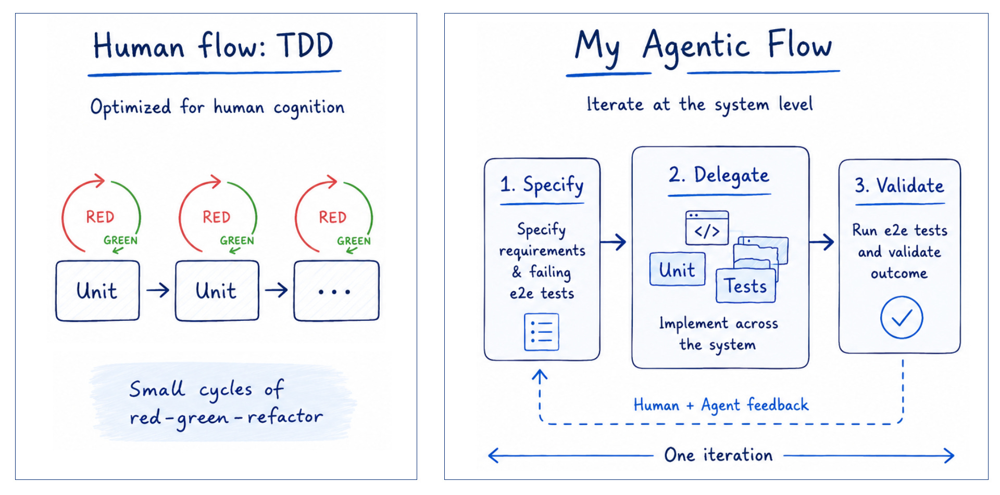

<!-- START doctoc generated TOC please keep comment here to allow auto update -->
<!-- DON'T EDIT THIS SECTION, INSTEAD RE-RUN doctoc TO UPDATE -->
**Table of Contents** *generated with [DocToc](https://github.com/thlorenz/doctoc)*

- [XP and GenAI](#xp-and-genai)

<!-- END doctoc generated TOC please keep comment here to allow auto update -->

# XP and GenAI

- [TDD and Generative AI – A Perfect Pairing?](https://www.youtube.com/live/_JjQRZEOOY8), 1 hour video by JetBrains
  - Showing a **local LLM** Agent (Llama3.1), a tool "Test Driven Generator"
- [TDD inside the agent loop - theater or actual value?](https://martinfowler.com/articles/exploring-gen-ai/tdd-in-the-agent-loop.html) - 10.08.2026
  - <https://github.com/birgitta410/tdd-comparisons/>
  - <https://github.com/birgitta410/local-coding-evals/tree/tdd>
    - [TDD instructions](https://github.com/birgitta410/tdd-comparisons/blob/main/instructions.ts)
  - Expone que el agente no respetaba TDD 🤷
  - "TDD is a process that doesn't seem to “come natural” to models."
    - Los modelos no están entrenados viendo el proceso, sino soluciones finales
  - Experimento equivalente a los típicos de dos grupos de estudiantes/desarrolladores, uno haciendo TDD y otro no haciéndolo: ¿pero qué esperas demostrar ahí, si TDD requiere meses/años de práctica?
  - How much sense does this really make when the human is removed?
    - ¡Para aprender!
  - "I think at this point there is generally more and more evidence that being overly specific about how we want a model to do something is not a sustainable approach."
    - ¿de qué habla? ¿De los tests por adelantado? ¿De la especificación por adelantado?
  - 3x tokens con TDD
  - "I personally have stopped telling my coding agents to write tests first, let alone do TDD (which I never did, to be honest)" → ese “which I never did” me parece la clave
- [The Last Year Has Changed Everything I Knew About TDD After 20 Years](https://www.youtube.com/watch?v=wK5WgbqtI50) - 23.09.2026
  - [Canon TDD, by Kent Beck](https://newsletter.kentbeck.com/p/canon-tdd)
  - Some things missing in Birgitta's experiment, like a test list and a good/strong refactoring prompt.
  - The prompt and setup is not good enough to show if LLMs can actually benefit from TDD
- [TDD with LLMs: theatre?](https://gregorriegler.com/2026/10/03/tdd-with-llms-theatre.html) - 03.10.2026
  - Si el LLM escribe los tests a posteriori, son tests tautológicos, no prueban nada.
- [The Industry Is Catching Up: The Only Way to Generate AI Code That Works](https://www.youtube.com/watch?v=EkH_uoybj8k) - 21.10.2026
  - You need some verification: ATDD
  - The 3 fundamental issues
    1. Specify what we want!
    - Natural Language Prompts are too vague to be precise
    1. Verify that we got it!
    - AI can change more than we asked for
    1. Proceed in small, safe, steps!
    - Humans can't keep up
  - Proposal
    - Humans write or approve the Acceptance tests (specs)
    - AI implement the tests (4 layer model)
      - Upper layer: Test Cases (written in the language of the problem domain)
      - DSL
      - Protocol Driver (it knows how to talk to the real systems through its UI, its API, etc.)
      - Lower layer: System Under Test
    - AI adds tests to the deployment pipeline
    - AI implements code to make the tests pass
    - Tests run on commit (CD style) outside AI control and verify results.
- [Practices I Abandoned with Agents: An Ode to Test-Driven Development, by Adam Tornhill](https://adamtornhill.substack.com/p/practices-i-abandoned-with-agents)
  - Moved from TDD to spec-first more end-to-end, at a higher level
  - "As such, it took me a couple of years to become good enough at software design to pull off TDD effectively."
  - "I found it much more productive to experiment in the REPL." --> WTF!!
  - "Part of what makes TDD work is that it allows us to simulate a fast feedback loop in languages without a REPL" --> WTF!!!!!!!!!!!!!!!!!
  - "So, in my agentic flow, tests come first. That doesn’t mean it is TDD, though." --> end-to-end tests
  - "The agentic feedback loop is larger and (much) less granular.
    One agentic iteration would have spanned tens of red-green-refactor cycles with tons of small design decisions. Those are now done in one sweep."
  - "Code is no longer for my consumption" --> IMO highly risky
  - His understanding of TDD is mostly "unit testing" 🤷
  
- [Case Study: Refactoring at Scale with Agents](https://codescene.com/blog/case-study-refactoring-at-scale-with-agents)  
  - 300K lines of code refactored in three weeks
  - Our case study demonstrates agentic refactoring at scale on a real-world, non-trivial codebase: [Street Fighter III: 3rd Strike](https://en.wikipedia.org/wiki/Street_Fighter_III:_3rd_Strike).
  - We refactor the whole codebase to eradicate any technical debt, bringing the code to a level where new features could be added safely with AI.
  - The [CodeHealth MCP Server](https://codescene.com/product/code-health-mcp) was used as the objective quality signal and agentic feedback loop.
  - We designed a process where a refactoring playbook is built up iteratively.
