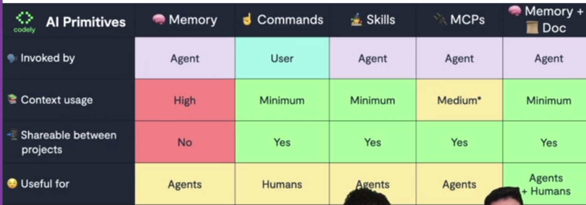

<!-- START doctoc generated TOC please keep comment here to allow auto update -->
<!-- DON'T EDIT THIS SECTION, INSTEAD RE-RUN doctoc TO UPDATE -->
**Table of Contents** *generated with [DocToc](https://github.com/thlorenz/doctoc)*

- [Agentic AI programming: practical foundations](#agentic-ai-programming-practical-foundations)
  - [[GRATIS] 💻 Programación agéntica](#gratis--programación-agéntica)
    - [🔥 Lo que tienes que saber de IA para Programar](#-lo-que-tienes-que-saber-de-ia-para-programar)
    - [Criteria for choosing programming models](#criteria-for-choosing-programming-models)
  - [🧠 AGENTS.md: Añadir memoria para que los agentes actúen como esperas](#-agentsmd-añadir-memoria-para-que-los-agentes-actúen-como-esperas)
  - [🔧 AGENTS.md escalables y mantenibles para trabajar en equipo: El Agent Harness](#-agentsmd-escalables-y-mantenibles-para-trabajar-en-equipo-el-agent-harness)
  - [🥘 Skills: Añade comandos y habilidades a tus agentes](#-skills-añade-comandos-y-habilidades-a-tus-agentes)
  - [🔌 MCPs: Añadir herramientas externas](#-mcps-añadir-herramientas-externas)
  - [☝️ Evolución en la forma de trabajar](#-evolución-en-la-forma-de-trabajar)
  - [💰 Calcular y reduce costes programando con IA](#-calcular-y-reduce-costes-programando-con-ia)
  - [👛 Optimización de contexto](#-optimización-de-contexto)
  - [🛡️ Seguridad y hooks](#-seguridad-y-hooks)
  - [🫢 Demo de uso real: Desde la tarea en GitHub hasta producción con Progressive Disclosure](#-demo-de-uso-real-desde-la-tarea-en-github-hasta-producción-con-progressive-disclosure)

<!-- END doctoc generated TOC please keep comment here to allow auto update -->

# Agentic AI programming: practical foundations

- [Curso de Programación agéntica con IA: Fundamentos prácticos](https://codely.com/cursos/programacion-agentica-con-ia-fundamentos-practicos-ag3n)
- Premium
- <https://github.com/CodelyTV/agentic_programming-course>
  - <https://github.com/islomar/agentic_programming-course>
- ~7 hours
- February 2026

## [GRATIS] 💻 Programación agéntica

### 🔥 Lo que tienes que saber de IA para Programar

- Conceptos
  - **Agents**
    - local: Junie, Gemini, Opencode, Cursor, Antigravity, Claude Code, etc.
    - remote: Codex (OpenAI), GitHub Copilot, Jules, Devin, etc.
    - Algunos remotos también ofrecen CLI para ejcutarse en local, como Codex o GH Copilot.
    - Algunos locales permiten ejecución desde GitHub o Slack
  - Antes de comenzar una conversación, ya viene el **static context**:
    - System prompt
    - Tools definition
      - e.g.: bash commands, web search
    - MCPs
    - Skills
    - Static memory
  - **Progressive disclosure**: alternativa a "static context", con un descubrimiento dinámico de qué tools o skills o MCPs existen.
  - **Dynamic context**
    - Dynamic Memory (AGENTS.MD se cargan según se encuentran)
    - Messages
    - Tool/MCP calling
    - Skills loading
  - **Memory**
    - <https://agents.md/>
      - `AGENTS.md`, you can have several ones, in different subdirectories
      - Todos standard excepto Claude Code (you can create symbolic links)
    - Context window != Attention window!!
  - **Commands**
    - Starting to reduce its use because of the Skills
  - **Skills**
    - Buena forma de distribuir la documentación
  - **MCPs**
    - Contexto de otro sistema externo, incluye gestionar autenticación, etc.
    - Posible ventaja frente a skills, por ejemplo para acceder a PostgreSQL: MCP con read-only user
    

### Criteria for choosing programming models

- Los modelos locales no permiten sacar todo el jugo que ofrencen los frontier models
- <https://arena.ai>
  - <https://arena.ai/leaderboard>
  - <https://arena.ai/leaderboard/code>
    - Very well updated
- <https://www.swebench.com/index.html>
  - Official leaderboards
  - Not always updated
- <https://llm-price.com/>
- <https://cursor.com/docs/models-and-pricing>
- <https://github.com/AlexsJones/llmfit>
- <https://hasbeenreleased.com/>
  - Para enterarte cuando sale un modelo nuevo
- Modo "thinking" en los modelos: le da varias pasadas

## 🧠 AGENTS.md: Añadir memoria para que los agentes actúen como esperas

- <https://github.com/CodelyTV/agentic_programming-course/tree/main/02-memory/1-agents_on_all_editors>
- Claude Code does NOT use `AGENTS.md`, but `CLAUDE.md`. [We create symlinks](https://github.com/CodelyTV/agentic_programming-course/blob/main/02-memory/1-agents_on_all_editors/scripts/generate-claude-symlinks.sh)

## 🔧 AGENTS.md escalables y mantenibles para trabajar en equipo: El Agent Harness

- TBD

## 🥘 Skills: Añade comandos y habilidades a tus agentes

- TBD

## 🔌 MCPs: Añadir herramientas externas

- TBD

## ☝️ Evolución en la forma de trabajar

- TBD

## 💰 Calcular y reduce costes programando con IA

- TBD

## 👛 Optimización de contexto

- TBD

## 🛡️ Seguridad y hooks

- TBD

## 🫢 Demo de uso real: Desde la tarea en GitHub hasta producción con Progressive Disclosure

- TBD
